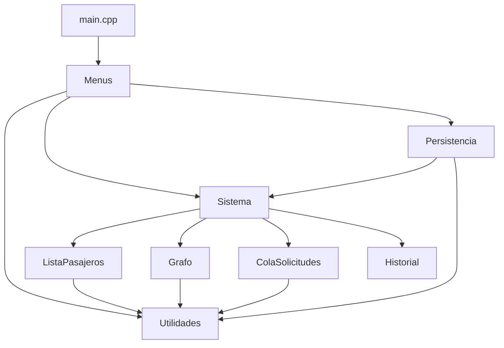

# SITRAC – Sistema Inteligente de Transporte y Gestión de Rutas

Taller de Estructura de Datos (C++) – jueves 12 de noviembre de 2026.
Primera versión ejecutable y modular. Todas las estructuras centrales están
implementadas a mano: **no se usa `std::list`, `std::queue`, `std::stack` ni
`std::vector`/`std::map` para almacenar los datos del sistema**.

**Integrantes:** _(escribir nombres aquí)_

## Compilar y ejecutar

Requiere un compilador con C++11 (g++ de MinGW/MSYS2, o similar).

```bash
g++ -std=c++11 -Wall -Wextra -static -o sitrac.exe src/*.cpp
./sitrac.exe
```

En Windows también puede usarse `compilar.bat`.

Para repetir las pruebas automáticas de la guía (CP-01 a CP-06):

```bash
./sitrac.exe < tests/entrada_pruebas.txt > tests/salida_pruebas.txt
```

## Estructura del repositorio

```
src/
  main.cpp              punto de entrada (solo crea el Sistema y abre el menú)
  Menus.h/.cpp          interfaz de consola: menú principal y submenús
  Sistema.h             agrupa las 4 estructuras
  ListaPasajeros.h/.cpp lista enlazada propia
  Grafo.h/.cpp          grafo con lista de adyacencia propia
  ColaSolicitudes.h/.cpp cola enlazada propia
  Historial.h/.cpp      pila enlazada propia
  Persistencia.h/.cpp   guardar / cargar en archivo de texto
  Utilidades.h/.cpp     lectura segura de entradas y texto
tests/entrada_pruebas.txt  entradas para los casos CP-01..CP-06
```

## Diagrama modular



`Menus` solo interactúa con el usuario; las reglas de datos (duplicados,
distancia válida, cola vacía…) viven dentro de cada estructura.

## Tabla de estructuras (operación → estructura → justificación)

| Operación | Estructura | Justificación |
|---|---|---|
| Insertar / buscar / actualizar / eliminar / listar pasajeros | **Lista simplemente enlazada** (`ListaPasajeros`) | Los pasajeros se agregan y quitan con frecuencia; no hay que reservar tamaño ni desplazar elementos. Buscar es O(n), aceptable para el volumen del taller. |
| Ciudades y rutas, vecinos, eliminar ciudad | **Grafo no dirigido ponderado con lista de adyacencia** (`Grafo`) | El mapa es disperso (pocas rutas por ciudad), así que la lista de adyacencia usa O(V+E) de memoria frente a O(V²) de una matriz, y listar vecinos cuesta O(grado). |
| Ruta más corta | **Dijkstra O(V²)** sobre el grafo | Distancias positivas; no necesita cola de prioridad para este tamaño. |
| Solicitudes de viaje (encolar / atender / frente) | **Cola enlazada con punteros `frente` y `fin`** (`ColaSolicitudes`) | Se atiende por orden de llegada (FIFO); encolar y atender son O(1) sin desplazar nada. |
| Viajes atendidos | **Pila enlazada** (`Historial`) | Lo más útil es ver primero lo más reciente (LIFO); apilar es O(1). |
| Guardar / cargar | Archivo de texto delimitado por `\|` | Legible y fácil de revisar; la carga se valida completa antes de reemplazar datos. |

## Reglas de integridad que implementa el sistema

- **Ciudad repetida** (sin distinguir mayúsculas): se rechaza, no se crea nodo extra.
- **ID de pasajero duplicado**: se rechaza.
- **Distancia ≤ 0 o no numérica**: se rechaza.
- **Eliminar ciudad**: borra también todas las aristas que la apuntan (sin referencias colgantes). Si hay solicitudes en cola que la usan, no se permite.
- **Eliminar pasajero**: también retira sus solicitudes pendientes de la cola.
- **Encolar**: exige pasajero existente, ciudades existentes, distintas y con ruta entre ellas.
- **Cola vacía**: atender / ver frente informan en lugar de fallar.
- **Entradas erróneas** (letras donde va un número, vacío, fuera de rango): se informa y se vuelve al menú; el programa nunca queda en un ciclo infinito ni termina por un error de usuario.

## Casos de prueba obligatorios

| Caso | Entrada / acción | Resultado esperado |
|---|---|---|
| CP-01 | Registrar ciudad Bogotá dos veces | Rechaza duplicado sin crear nodo extra |
| CP-02 | Eliminar pasajero inexistente | Informa sin romper la lista |
| CP-03 | Atender cola vacía | Gestiona subdesbordamiento |
| CP-04 | Crear ruta de distancia -5 | Rechaza el peso inválido |
| CP-05 | Eliminar ciudad conectada | No deja referencias colgantes |
| CP-06 | Ingresar letras donde se pide número | Recupera menú sin ciclo infinito |

El archivo `tests/entrada_pruebas.txt` ejecuta los seis casos en orden.
Evidencia de ejecución: ver `docs/EVIDENCIAS.md`.

## Funcionalidades

| Funcionalidad | Estado | Responsable |
|---|---|---|
| Menú principal persistente y submenús con Volver | Terminada | _(nombre)_ |
| Lista enlazada de pasajeros (CRUD + listar) | Terminada | _(nombre)_ |
| Grafo: alta/baja de ciudad, alta/baja de ruta, vecinos | Terminada | _(nombre)_ |
| Cola enlazada: encolar, atender, mostrar frente | Terminada | _(nombre)_ |
| Historial (pila) | Terminada | _(nombre)_ |
| Búsquedas (por ID, por nombre, ruta más corta) | Terminada | _(nombre)_ |
| Reportes (resumen general) | Terminada (básica) | _(nombre)_ |
| Guardar / cargar en archivo | Terminada | _(nombre)_ |
| Rutas dirigidas / tiempos de viaje | Pendiente | – |
| Cola con prioridades | Pendiente | – |
| Pruebas automatizadas con framework | Pendiente | – |

## Declaración de uso de IA

- **Qué se consultó:** se usó Claude (Anthropic) como asistente para generar la
  primera versión del código en C++ a partir de la guía de clase, la estructura
  de módulos y el borrador de este README.
- **Qué fue revisado y corregido por el equipo:** _(completar: qué leyeron,
  qué probaron, qué cambiaron y por qué)_.
- Cada integrante debe poder explicar y modificar cualquier parte del código.
